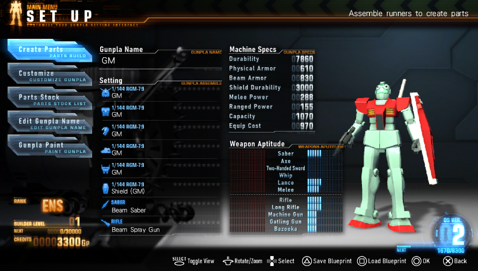
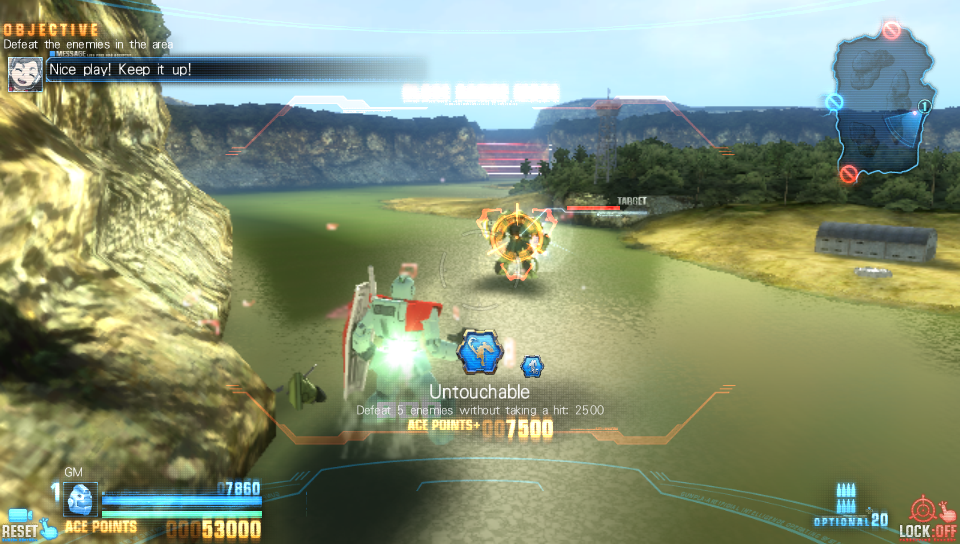
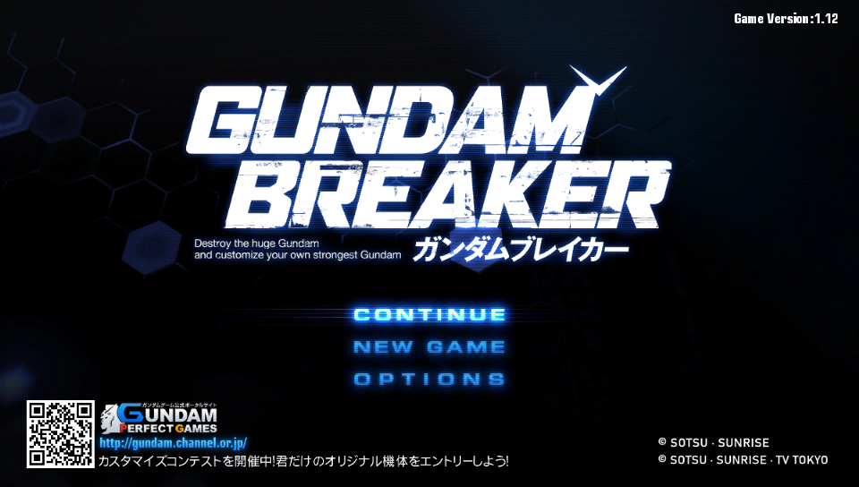
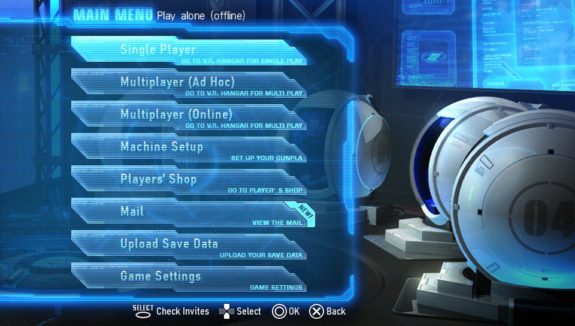
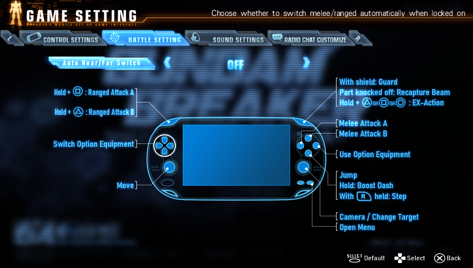
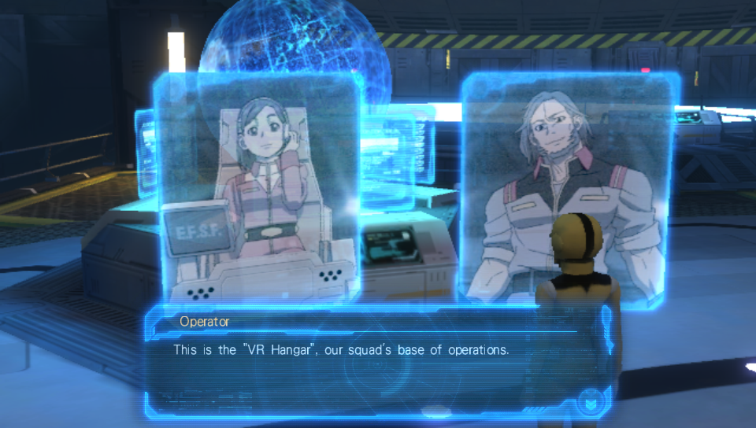
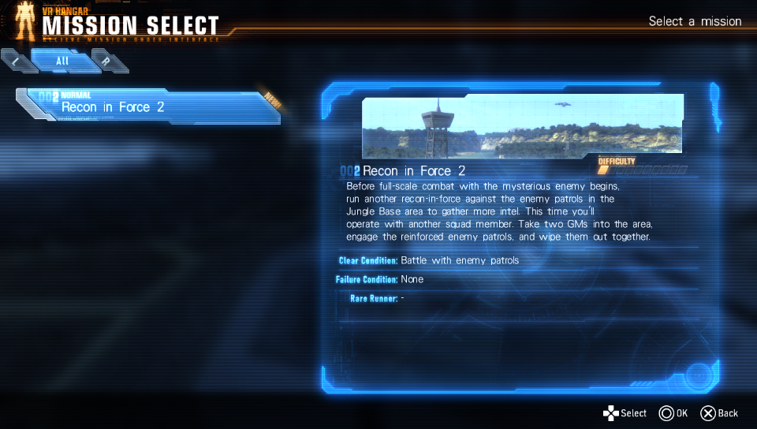
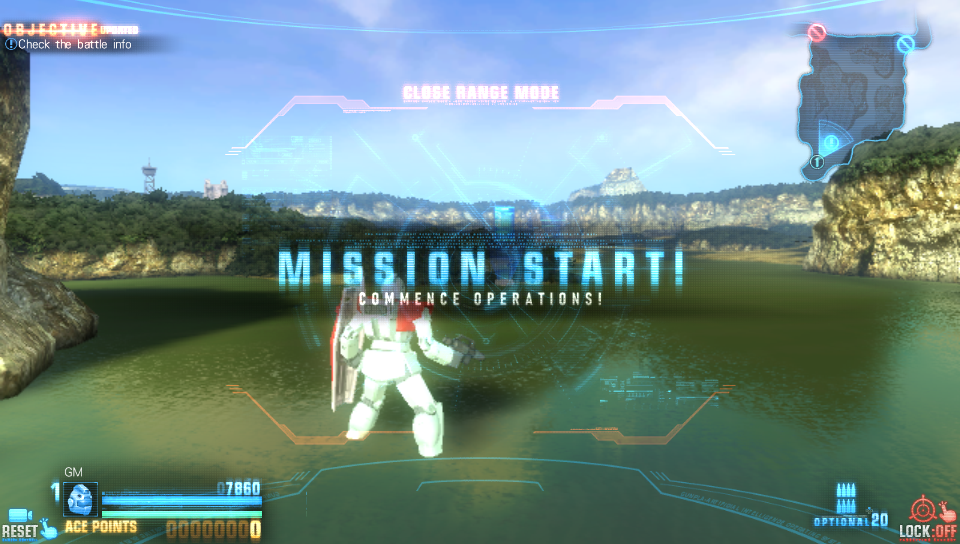
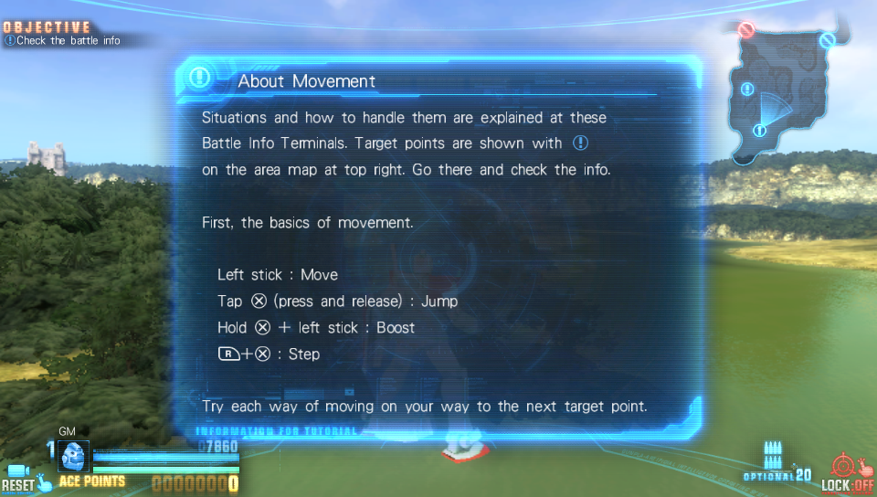

# Gundam Breaker (PS Vita) — English Patch

A fan English translation patch for **Gundam Breaker** (the first game; PS Vita, Japan only, `PCSG00126`,
Bandai Namco, 2013).

Mobile suit, part, weapon, skill and menu names follow the official English of *Gundam Breaker 3* (Asia English
release) wherever it has them. Everything else is a new translation.

> **Status: v0.1.0, first full translation pass, tested on a real PS Vita.** Menus, help, missions,
> dialogue, part and weapon names, part descriptions and most UI images are in English. Many lines are first
> drafts that still need a review.
>
> **Patch it in your browser with the [web patcher](https://irxd.github.io/gundam-breaker-vita-en/)** or download
> the patch files from the [Releases](https://github.com/irxd/gundam-breaker-vita-en/releases) page. See
> [Install](#install).

<p align="center"> </p>

More screenshots: [Screenshots](#screenshots).

## What's translated

- **Text:** menus, help pages, loading tips, mails, mission names, briefings and objectives, mission dialogue,
  radio chat, ace point messages, skills, chips, items and ranks.
- **Gunpla data:** part, weapon, option equipment and EX-Action names on the Set Up screen, part and weapon
  descriptions, decal names, map names.
- **Game program (eboot):** the default radio chat messages, the default Gunpla name, "Not equipped", lobby and
  room messages, keyboard prompts (needs the optional eboot step below).
- **UI images:** about 350 textures with Japanese labels (menu headers, buttons, HUD labels, rank and result
  screens, controller diagrams, the boot notice and the DLC store banner) redrawn in English.
- **Movies:** English subtitles over the burned-in Japanese ones in the opening, the closing ceremony, the
  developer's briefing, the shop owner's clips and the ending's epilogue.
- **Not translated:** credits staff names, the promo trailer, and the game's name on the home screen (optional
  fix below).

## Install

You patch files from **your own copy** of the game. No game data is included.

### What you need

- **The game:** PCSG00126, version 1.00 or with the 1.02 update. All game data comes from the base game
  (`ux0:app/PCSG00126`); the update only changes the game program.
- **On the Vita:** HENkaku/Ensō, the **rePatch** plugin and **VitaShell**. Recommended: **FAGDec**, for the game
  program (some text is built into it).
- **On the PC:** about 6 GB of free space, and Chrome or Edge for the
  [web patcher](https://irxd.github.io/gundam-breaker-vita-en/), or Python for the [manual install](#manual-install).

### Real PS Vita

**1. Copy the decrypted game files to your PC (VitaShell, over FTP)**

1. In VitaShell go to `ux0:app/PCSG00126/`, press △ and choose **Open decrypted**.
2. Press SELECT to start FTP, and copy the `masterPSP2` and `finalizedPSP2` folders (about 3.3 GB together) to a
   PC folder, e.g. `game/`. `finalizedPSP2` holds the movies; without it everything except the movie subtitles is
   still patched.

USB mode gives the still-encrypted files, so use FTP (or copy the folder to another place on the Vita with
VitaShell first, then over USB).

**Recommended: the game program (eboot) with FAGDec.** Some text (default radio chat, the default Gunpla name,
"Not equipped", lobby messages) is built into the game program, not the data files. Without this step that text
stays Japanese; everything else is still patched.

1. Open FAGDec, select the game and press ✕.
2. Select the eboot of the version you play: `ux0:patch/PCSG00126/eboot.bin` if the 1.02 update is installed,
   otherwise `ux0:app/PCSG00126/eboot.bin`. Press ✕.
3. Copy the `eboot.bin.elf` it made (in `ux0:FAGDec/patch/PCSG00126/` or `ux0:FAGDec/app/PCSG00126/`) to your PC.

**2. Patch**

1. Open the **[web patcher](https://irxd.github.io/gundam-breaker-vita-en/)** in Chrome or Edge.
2. Choose the folder you copied under **Game folder**. Only the files the patch needs are checked: the two data
   archives (about 2 GB, this takes a little while) and the 13 movies with subtitles. If you made `eboot.bin.elf`, choose it under **Game program (eboot)**.
3. Press **Patch** and pick a folder to save into. You get a `rePatch` folder there. Nothing is uploaded.

**3. Copy to the Vita**

Copy the `rePatch` folder to `ux0:` so the files end up in `ux0:rePatch/PCSG00126/`. Start the game.
Your files in `ux0:app` and `ux0:patch` are not changed.

**4. Optional: English game name on the home screen**

1. Don't install or delete apps on the Vita until you've finished these steps.
2. With VitaShell, copy `ur0:shell/db/app.db` to your PC. Keep this file as a backup.
3. In the web patcher, choose it under **Optional: English game name**. It saves a new `app.db`.
4. Copy the new `app.db` to `ur0:shell/db/app.db`, replacing it, and restart the Vita.

(Without the web patcher: `python tools/rename_title.py app.db`, from the release zip.)

### Manual install

1. Download `gundam-breaker-en-<version>.zip` from
   [Releases](https://github.com/irxd/gundam-breaker-vita-en/releases) and unzip it.
2. Install [Python](https://www.python.org/downloads/) 3.8 or newer.
3. In the unzipped folder, run (with your own paths from step 1 above):

   ```
   python tools\apply_patches.py "C:\path\to\game" "C:\path\to\eboot.bin.elf" --out out
   ```

   Leave out the `eboot.bin.elf` path if you don't have it.

   It finds each file by its path and checksum, patches it, and writes `out\rePatch\PCSG00126\...`.
   No other tools are needed (the script applies the xdelta patches itself; `xdelta3 -d -B 2147483648` works too).
4. Copy `out\rePatch` to `ux0:` on the Vita.

### Updating to a new patch version

Patch your **original** files again and replace the files in `ux0:rePatch/PCSG00126/`.

### Removing the patch

Delete `ux0:rePatch/PCSG00126/` (this also removes the patched `eboot.bin`). If you changed `app.db`, copy your
backup back to `ur0:shell/db/app.db` and restart the Vita.

## Known issues

- First translation pass: many lines are drafts, and some may overflow their text box. Please report them with a
  screenshot.
- Some data tables can't grow, so a few names use a shorter form (for example `HG Type 100` for the Hyaku-Shiki
  parts on the Set Up screen, `HG Banshee (Unicorn)`).
- Without the FAGDec `eboot.bin.elf`, the default radio chat, the default Gunpla name, "Not equipped" and lobby
  messages stay Japanese. The default radio chat and Gunpla name are copied into your save when it is created, so
  an existing save keeps the Japanese ones until you edit them.
- Credits staff names are still Japanese.
- The movie subtitles cover the Japanese ones with a dark box; the parts of a movie that show subtitles are re-encoded
  and may look slightly softer than the rest.

## Screenshots

Taken on a PS Vita.

<table>
<tr><td><br><sub>Title screen</sub></td><td><br><sub>Main menu</sub></td><td><br><sub>Game settings with the control diagram</sub></td></tr>
<tr><td><br><sub>Set Up</sub></td><td><br><sub>VR Hangar dialogue</sub></td><td><br><sub>Mission select</sub></td></tr>
<tr><td><br><sub>Mission start</sub></td><td><br><sub>Battle info terminal</sub></td><td><br><sub>Ace points and radio chat</sub></td></tr>
</table>

---

# For developers

## No game data here

The repository holds only tools, scripts and translations. `.gitignore` is an allow-list, and `dump/`, `game/`,
`work/`, `build/` and `release/` stay local. The committed translation files (`text/*.csv`) contain no Japanese game
text: each row has the line's id, the first 8 hex digits of the SHA-1 of the Japanese, the English and notes.
The release contains only xdelta patches.

## Building

See [CLAUDE.md](CLAUDE.md) for the local data layout and the rules, and [notes/](notes/) for the formats.

```
python -I scripts/extract_text.py          # dump -> work/*.csv (Japanese + English, local only)
python -I scripts/sync_text.py             # work/ -> text/*.csv (English only, committed)
python -I scripts/build_text.py            # text -> build/patched/PCSG00126/masterPSP2/GxArchivedFile000/002.dat
python -E -P scripts/build_images.py       # UI textures -> the same archives (Pillow: -E -P instead of -I)
python -I scripts/eboot_text.py build      # eboot text -> build/eboot/{app,patch}/eboot.bin
python -E -P scripts/build_movies.py       # movie subtitles (text/movies/*.json) -> build/patched/.../GP/movie/*.usm
python -I scripts/make_release.py 0.1.0    # all of the above, then xdelta patches -> release/, docs/patcher/patches/
```

`make_release.py` needs `xdelta3`, ffmpeg (`pip install imageio-ffmpeg`, or set `FFMPEG`) and the dump. It lays the
build out as `build/rePatch/PCSG00126/` (the two archives, the subtitled movies and `eboot.bin`), makes one patch per
changed file against the original in `dump/app`, and one eboot patch per
game version against FAGDec's `eboot.bin.elf`. Each patch is applied again and checked. The archives are 1.5 GB and
542 MB and their entries shift, so xdelta runs with a source window that covers the whole file (`-B 2147483648`);
`-S none -A` keeps the patches readable by the web patcher. The movies (CRI USM, MPEG-1) get their English from
`text/movies/*.json` (timings, the box of the Japanese text and the English): `scripts/build_movies.py` re-encodes
only the GOPs that show a subtitle and copies the rest, `tools/usm.py` rebuilds the container and `tools/mpeg1.py`
re-codes the pictures for the movies' 11-bit DC precision (see `notes/formats.md`). It writes `manifest.json` (source path, size, SHA-1 →
target path, size, SHA-1) for the web patcher and `apply_patches.py`. `--no-build` packages the current build;
`--local-zip` also zips `build/rePatch` for your own testing (it contains game data, so never publish it).

The web patcher (`docs/`) runs entirely in the browser: `patcher/vcdiff.js` applies the xdelta (VCDIFF) patches,
reading only the parts of the original file each window needs, `patcher/sha1.js` hashes the big files in slices,
`patcher/zip.js` writes the optional zip and `patcher/title.js` edits `app.db` / `param.sfo`.
`node scripts/test_web_patcher.mjs` runs the same code under Node against the dump and checks every patch.
To publish it, commit `docs/patcher/patches/` from a release build (it is git-ignored, so `git add -f`) and serve
`docs/` with GitHub Pages.

## Credits

- Translation and tools: this project
- Official English names: *Gundam Breaker 3* (Bandai Namco, PS Vita/PS4, Asia English)
- Tools used: VitaShell, rePatch, FAGDec, psvpfsparser, Vita3K, xdelta3, capstone, keystone, Pillow
- Release pipeline and web patcher adapted from the author's
  [Shin Gundam Musou](https://github.com/irxd/shin-gundam-musou-en) and
  [Battride War Sousei](https://github.com/irxd/battride-vita-en) English patches

This is an unofficial fan project and is not affiliated with Bandai Namco, Crafts & Meister or Sunrise.

## License

The code in this repository (tools and scripts) is released under the [MIT License](LICENSE).

The license does not cover the game or anything taken from it. *Gundam Breaker*, including its text, graphics and
code, belongs to its owners (©創通・サンライズ, Bandai Namco Games). The release patches are meant only for use with a
copy of the game you own.
